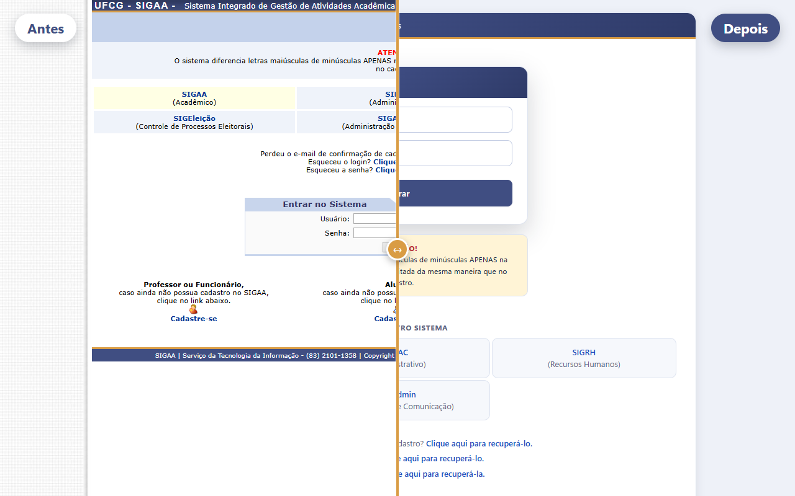
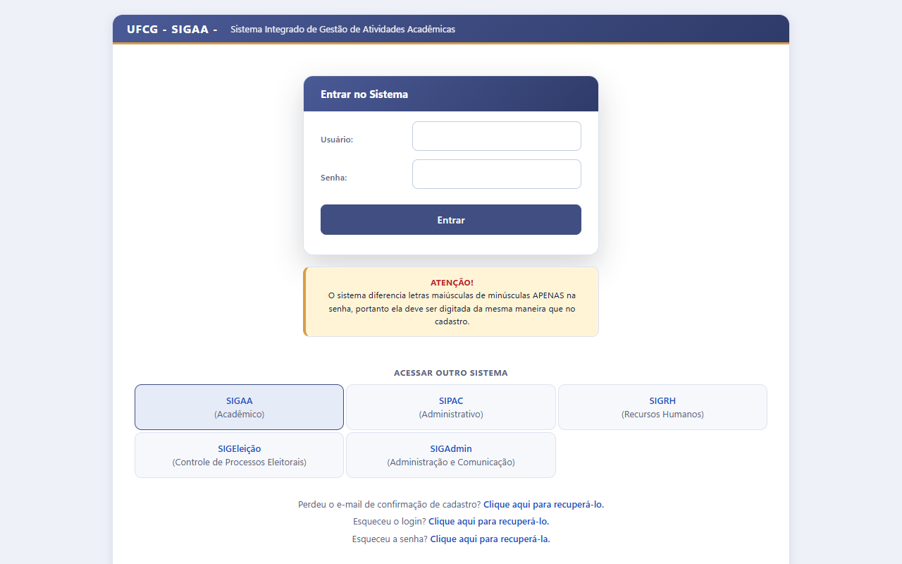
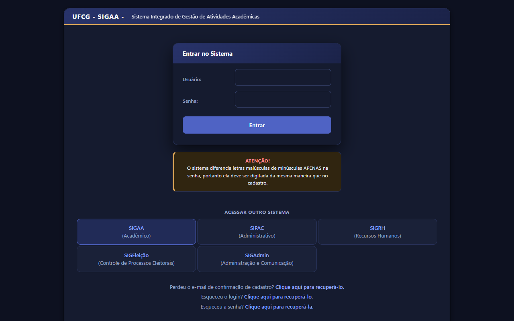
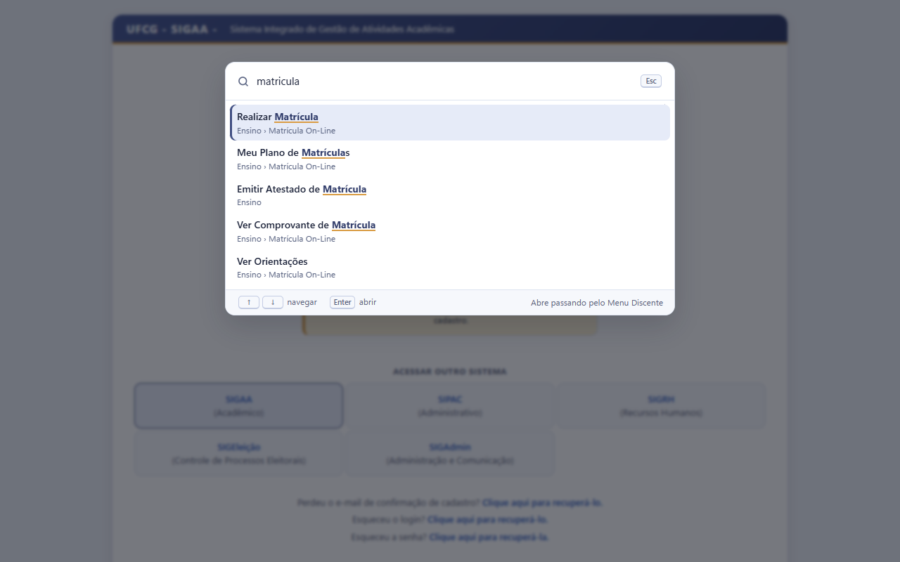
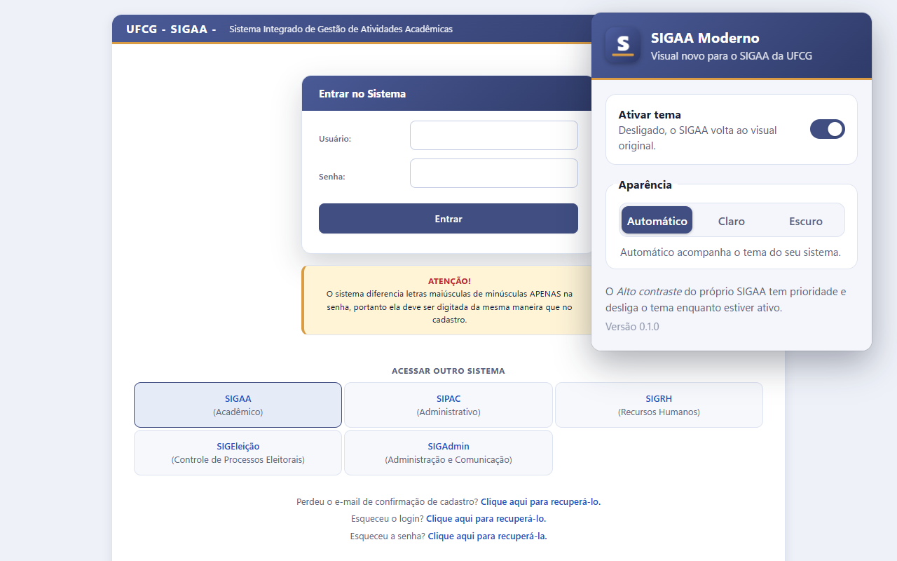

# SIGAA Moderno (UFCG)

Extensão de navegador que dá um visual moderno ao SIGAA da UFCG, com tema claro e escuro, sem alterar nenhum dado do sistema. É CSS mais alguns scripts pequenos (preferência de tema e busca no menu): não coleta nada e não faz requisições próprias. A busca no menu só aciona os mesmos itens do menu do SIGAA, como se você clicasse neles.

> Projeto independente, sem vínculo oficial com a UFCG ou a UFRN.

## Como fica

Mesma tela de login, com o SIGAA original à esquerda e com a extensão à direita:



<table>
  <tr>
    <td width="50%"></td>
    <td width="50%"></td>
  </tr>
  <tr>
    <td align="center">Tema claro</td>
    <td align="center">Tema escuro</td>
  </tr>
  <tr>
    <td width="50%"></td>
    <td width="50%"></td>
  </tr>
  <tr>
    <td align="center">Busca no menu (Ctrl+K), sem precisar de acento</td>
    <td align="center">Popup: liga/desliga e escolha do tema</td>
  </tr>
</table>

As capturas são só de telas públicas: o resto do sistema só aparece depois do login, e as capturas dele mostrariam dados pessoais.

## O que muda

- Largura fluida no lugar dos 984px fixos, fonte maior e hierarquia visual clara.
- Cabeçalho, painel do usuário e rodapé redesenhados (mesma identidade azul e laranja do SIGAA).
- Menu dropdown (Ensino, Pesquisa...) e popup de Módulos modernizados.
- **Busca no menu (Ctrl+K, ⌘K no Mac)**: os mais de 100 itens do menu do portal ficam pesquisáveis de qualquer tela logada, sem precisar de acento nem da ordem exata das palavras. Setas e Enter navegam; também há um botão "Buscar" no painel do usuário.
- Tabelas com cabeçalho discreto, zebra e destaque ao passar o mouse (listagens, notas, relatórios).
- Formulários e botões com foco visível e botão principal destacado.
- Mensagens de sucesso, aviso e erro em cartões.
- Portal do discente em cartões; Turma Virtual com texto das aulas legível (inclusive em tema escuro) e menu lateral com seções recolhíveis.
- **Turma Virtual com barra superior em destaque**: código e nome da turma grandes, com turma, semestre, horário e datas; avatar com as iniciais do usuário; botões com rótulo; botão Buscar (Ctrl+K); sessão e SAIR em pílulas.
- **Turma Virtual no celular** (janelas de até 900px): uma coluna que rola com a página, barra do sistema fixa no topo, menu lateral numa gaveta (botão ☰), botões de toque de 44px e os blocos da direita (andamento, notícias, avaliações) abaixo das aulas. As outras telas ainda são só para desktop.
- Tela de login em cartão, com o formulário no topo.
- Aviso de cookies como cartão no canto, sem cobrir o botão Entrar.
- Tema automático (acompanha o sistema), claro ou escuro, escolhido no ícone da extensão.

O **Alto contraste** do próprio SIGAA tem prioridade: enquanto ele estiver ligado (`html.contrast`), o tema fica desligado.

## Instalação

Há duas formas de usar a extensão. Escolha a que combina com você:

| | **Opção 1: Chrome Web Store** | **Opção 2: baixar e ajustar no seu computador** |
| --- | --- | --- |
| Para quem | Quem só quer usar | Quem quer mudar cores, telas ou recursos |
| Instalação | Um clique | Baixar a pasta e carregar no navegador (uns 2 minutos) |
| Atualizações | Automáticas | Manuais (baixar de novo ou `git pull`) |
| Editar o código | Não | Sim: a mudança aparece ao recarregar a extensão |

> Não deixe as duas versões ligadas ao mesmo tempo, senão o visual é aplicado duas vezes. Se for personalizar, desative ou remova a da loja.

### Requisitos

- Um navegador baseado em Chromium, **versão 123 ou superior**: Google Chrome, Microsoft Edge ou Brave (e similares, como Vivaldi e Opera). Para ver a versão, abra `chrome://version` (ou `edge://version`, `brave://version`). Em versões anteriores o tema não é aplicado direito, porque o CSS usa `light-dark()` e aninhamento.
- Computador (Windows, macOS ou Linux). O Chrome no celular não tem extensões.
- Acesso ao SIGAA da UFCG como de costume. A extensão só muda o visual, não faz login por você.
- Firefox e Safari ainda não são suportados.

### Opção 1: pela Chrome Web Store

**Link da loja:** [SIGAA Moderno na Chrome Web Store](https://chromewebstore.google.com/detail/sigaa-moderno-ufcg/gmpbhgljjdbimppdologlnfkchldbhkh) (ou pesquise por "SIGAA Moderno" na Chrome Web Store).

1. Abra a página da extensão na Chrome Web Store (link acima).
2. Clique em **Usar no Chrome** (*Add to Chrome*, se estiver em inglês) e confirme.
   - No **Edge**, abra o mesmo link: ele aceita extensões da loja do Chrome e, se pedir, permita extensões de outras lojas.
   - No **Brave**, funciona como no Chrome.
3. *(Opcional)* Fixe o ícone na barra: clique no ícone de peça de quebra-cabeça e depois no alfinete ao lado de "SIGAA Moderno".
4. Abra o SIGAA: <https://sigaa.ufcg.edu.br/sigaa/verTelaLogin.do>. Abas do SIGAA que já estavam abertas precisam ser recarregadas (F5).

**Atualizar:** é automático, o navegador instala as versões novas sozinho.
**Desinstalar:** clique com o botão direito no ícone da extensão e escolha **Remover do Chrome** (ou use o botão **Remover** em `chrome://extensions`).

### Opção 2: baixar e ajustar no seu computador

Aqui você usa a pasta do projeto como extensão, então pode editar os arquivos e ver o resultado. Não precisa de Node, npm nem build.

1. **Baixe o projeto**, por uma das opções:
   - **Para só instalar:** abra a [última Release](https://github.com/RonildoLima/extensao-sigaa/releases/latest), baixe `sigaa-moderno-vX.Y.Z.zip` em **Assets** e extraia numa pasta (no Windows: botão direito → **Extrair tudo**). O `.zip` já traz só a extensão, pronta para carregar.
   - **Para personalizar** (recomendado): `git clone https://github.com/RonildoLima/extensao-sigaa.git`. Nesse caso a própria pasta clonada é a extensão, e o Git permite desfazer qualquer mudança.
2. **Deixe a pasta num lugar fixo** (por exemplo `Documentos\sigaa-moderno`). O navegador lê os arquivos direto dela: se você mover, renomear ou apagar a pasta, a extensão para de funcionar.
3. **Abra a página de extensões** digitando na barra de endereço: `chrome://extensions` (Chrome), `edge://extensions` (Edge) ou `brave://extensions` (Brave).
4. **Ligue o Modo do desenvolvedor**: no Chrome e no Brave fica no canto superior direito; no Edge, no menu lateral esquerdo.
5. Clique em **Carregar sem compactação** (*Load unpacked*, se o navegador estiver em inglês) e selecione a pasta que **contém o arquivo `manifest.json`**. Se a pasta escolhida só tem outra pasta dentro (acontece ao extrair o `.zip` dentro de uma pasta com o mesmo nome), escolha a de dentro.
6. **SIGAA Moderno (UFCG)** aparece na lista, ligada e sem o botão vermelho **Erros**.
7. *(Opcional)* Fixe o ícone na barra: clique no ícone de peça de quebra-cabeça e depois no alfinete ao lado de "SIGAA Moderno".
8. Abra o SIGAA: <https://sigaa.ufcg.edu.br/sigaa/verTelaLogin.do>. Abas do SIGAA que já estavam abertas precisam ser recarregadas (F5), porque o navegador só injeta a extensão ao carregar a página.

**Depois de mudar um arquivo:** em `chrome://extensions`, clique no botão **Recarregar** (seta circular) no cartão da extensão e recarregue (F5) a aba do SIGAA.

**Atualizar:**
1. Instalou pela Release: baixe o `.zip` da versão nova e extraia **por cima da pasta atual**, substituindo os arquivos (assim o navegador continua apontando para o mesmo lugar). Instalou com Git: rode `git pull` na pasta. Se você mudou arquivos, o `git pull` pode pedir para resolver conflitos; peça ajuda ao seu agente de IA ou guarde as mudanças antes com `git stash`.
2. Recarregue a extensão e a aba, como acima. A versão instalada aparece no cartão e no rodapé do popup.

**Desinstalar:** em `chrome://extensions`, clique em **Remover** no cartão da extensão. Depois pode apagar a pasta.

### Conferir se funcionou

- Na tela de login, o formulário aparece num cartão, com o visual azul e laranja renovado.
- Clique no ícone da extensão: o popup tem o interruptor **Ativar tema** e a escolha de **Aparência** (Automático, Claro, Escuro). Automático acompanha o tema do seu sistema.
- Depois de entrar, pressione **Ctrl+K** (⌘K no Mac) para abrir a busca no menu.

### Permissões

A extensão só atua em `https://sigaa.ufcg.edu.br/*` e `https://sigrh.ufcg.edu.br/cxpostal/*` (Caixa Postal) e pede a permissão `storage` para guardar suas preferências. Não pede acesso a histórico, abas, cookies nem a outros sites. Detalhes em [Privacidade](#privacidade).

### Problemas comuns

| Sintoma | O que fazer |
| --- | --- |
| "Manifest file is missing or unreadable" / "Não foi possível carregar o manifesto" | Você escolheu a pasta errada. Selecione a que tem o `manifest.json` direto dentro dela. |
| O SIGAA continua com o visual antigo | Recarregue a aba (F5). Confira se a extensão está ligada em `chrome://extensions` e se **Ativar tema** está marcado no popup. Em **Detalhes → Acesso ao site**, não deixe como "Ao clicar" ou restrito a outros sites. Confirme que o navegador é a versão 123 ou mais nova. |
| Editei um arquivo e nada mudou | O CSS e os scripts só entram quando a página carrega. Clique em **Recarregar** no cartão da extensão em `chrome://extensions` e depois em F5 na aba do SIGAA. |
| O visual parece aplicado duas vezes | A versão da loja e a pasta local estão ligadas juntas. Desative uma delas em `chrome://extensions`. |
| O tema some só em algumas telas | O **Alto contraste** do próprio SIGAA está ligado (botão de contraste do cabeçalho) e tem prioridade. Desligue-o para voltar ao tema. |
| O tema ficou claro (ou escuro) demais | Escolha **Claro** ou **Escuro** no popup, no lugar de Automático. |
| Ctrl+K não abre a busca | A busca só funciona com o tema ativo: **Ativar tema** marcado no popup e **Alto contraste** do SIGAA desligado. O menu em si só existe depois do login, então no primeiro uso a busca pede para abrir o Portal do Discente uma vez, para copiar os itens. |
| Apareceu o botão **Erros** no cartão da extensão | Clique nele, copie a mensagem e abra uma issue no GitHub (ou mostre ao seu agente de IA, que costuma achar a causa). |

## Personalizar com IA

O repositório já vem preparado para agentes de IA (Claude Code, Codex, Cursor, GitHub Copilot e similares). O arquivo [AGENTS.md](AGENTS.md) explica o projeto, em qual arquivo mexer para cada coisa e o que não quebrar. O Claude Code lê o [CLAUDE.md](CLAUDE.md), que aponta para ele.

**Como começar**

1. Baixe o projeto como na [Opção 2](#opção-2-baixar-e-ajustar-no-seu-computador), de preferência com `git clone`, para poder desfazer o que não gostar.
2. Abra a pasta no seu agente. No Claude Code: `cd extensao-sigaa` e depois `claude`. Nos outros, abra a pasta no editor.
3. Peça o que quiser:
   - **Claude Code:** digite `/personalizar`. Ele pergunta o que você quer mudar, ou você já diz: `/personalizar deixe o tema verde`.
   - **Outros agentes:** cole o prompt abaixo.
4. Em `chrome://extensions`, clique em **Recarregar** na extensão e dê F5 no SIGAA para ver o resultado.
5. Gostou? Faça o commit. Não gostou? `git restore .` desfaz tudo que ainda não foi commitado.

**Prompt para colar em qualquer agente**

```text
Leia o AGENTS.md e o README.md deste projeto. Ele é a extensão de navegador "SIGAA Moderno".
Quero personalizá-la: [DESCREVA AQUI O QUE VOCÊ QUER MUDAR].
Se eu ainda não disse o que quero, me pergunte com opções simples, uma pergunta por vez.
Mude o mínimo necessário, me explique em português simples o que você alterou e me diga
como recarregar a extensão para eu ver o resultado.
```

**Exemplos de pedidos**

- "Troque o azul e o laranja por tons de verde."
- "Aumente a fonte das tabelas de notas."
- "Deixe o tema escuro mais escuro."
- "Mude o atalho da busca de Ctrl+K para Ctrl+J."
- "Esconda a barra de rolagem do menu lateral da Turma Virtual."

**Cuidados**

- O agente não tem o seu login do SIGAA e não deve pedir sua senha. Para ajustar uma tela que só aparece logado, descreva o problema ou envie uma captura **depois de apagar nome, matrícula e qualquer dado pessoal**.
- Não envie nem commite capturas com dados pessoais.
- Mudanças que fazem a extensão ler outros dados, acessar outros sites ou fazer requisições de rede mudam a política de privacidade ([PRIVACY.md](PRIVACY.md)). O `AGENTS.md` manda o agente avisar você antes.

## Como funciona

| Arquivo | Papel |
| --- | --- |
| `manifest.json` | Manifest V3. Injeta CSS e `early.js` em `sigaa.ufcg.edu.br` e na Caixa Postal (`sigrh.ufcg.edu.br/cxpostal`). |
| `src/content/early.js` | Roda em `document_start`, antes da primeira pintura. Marca o `<html>` com `data-sg`, `data-sg-theme` e `data-sg-scheme` para o CSS escolher o tema sem "piscar". |
| `src/styles/tokens.css` | Cores, raios, sombras. Claro e escuro com `light-dark()`. |
| `src/styles/*.css` | Um arquivo por área: `base`, `shell`, `tables`, `forms`, `messages`, `portal`, `caixa-postal`, `turma-virtual`, `turma-header` (barra superior), `turma-mobile` (celular), `reports`, `public`, `login`, `palette`. |
| `src/content/turma.js` | Só na Turma Virtual: põe o `<meta viewport>` (o SIGAA não tem), monta a faixa da turma e o avatar, e cria o botão Buscar e o ☰ da gaveta. Lê o texto dos próprios elementos do SIGAA, que continuam na página. |
| `src/content/turma-layout.js` | Mundo MAIN, `document_end`: lê `--sg-turma-header-h` e pede ao jQuery layout essa altura para o painel norte (`sizePane`). |
| `src/content/menu-bridge.js` | Roda no mundo MAIN da página (os content scripts normais não enxergam variáveis do SIGAA) e copia o array do menu para um `<script type="application/json">` inerte. |
| `src/content/palette.js` | A busca Ctrl+K: lê esse JSON, monta a paleta (`<dialog>` modal), guarda uma cópia do menu e abre o item escolhido. |
| `src/popup/` | Popup com o interruptor e a escolha de tema (salva em `chrome.storage.sync`). |

Todas as regras ficam dentro de `html[data-sg="on"]:not(.contrast) { ... }` (CSS aninhado). Isso:

- liga e desliga o tema inteiro por um atributo;
- dá especificidade suficiente para vencer o CSS do SIGAA, que usa muitos seletores com `#id`;
- respeita o Alto contraste nativo.

### Particularidades do SIGAA que moldam o código

- **A URL não identifica a tela.** Depois do login quase tudo roda em `discente.jsf` ou `turmas.jsf` (JSF navega por POST). O CSS reconhece cada tela pelo DOM (`#baseLayout` na Turma Virtual, `#relatorio-*` nos relatórios, `form[name="loginForm"]` no login).
- **Ids `j_id_jsp_*` e os hashes dos bundles mudam a cada deploy.** Nunca são usados como seletor.
- **Algumas cores vêm de `style=""` inline** (barra de integralização, conteúdo escrito por professores). Nesses casos o CSS usa `!important` de propósito e comenta o motivo.
- **A Turma Virtual usa jQuery layout**, que calcula as dimensões dos painéis. O CSS só mexe em cores, bordas e tipografia nessa tela.
- **A altura da barra superior da Turma Virtual está no JS da turma** (`north: { size: 48 }`) e os outros painéis são posicionados a partir dela. Para ela crescer (88px = 34 da barra do sistema + 54 da faixa da turma), o CSS declara `--sg-turma-header-h` e o `turma-layout.js` chama a API do plugin (`sizePane`), que reposiciona tudo e mantém o tamanho nos resizes. Sem o tema, a variável some e volta para 48px. Quase tudo na barra tem estilo inline (fontes em `pt`, posições absolutas, larguras dos botões), por isso o CSS usa `!important` nesses pontos; o `skin.css` do PrimeFaces também põe `padding !important` em `.ui-button-text`.
- **Celular na Turma Virtual:** o plugin grava `position/top/left/width/height` inline a cada resize, então até 900px o CSS desfaz o layout absoluto com `!important` (painéis em fluxo normal, `#cabecalho` com `display: contents` para a barra do sistema poder ficar `sticky`) e a gaveta do menu usa `display: block !important`, porque com pouco espaço o plugin esconde o painel com `display:none` inline. O formulário do menu traz um `--` solto (resto do JSF) e o `input#auxEsconderSubMenu` de 1px, que o estilo genérico de input deixaria visíveis.
- **O menu lateral da Turma Virtual é uma sanfona do RichFaces** que, ao carregar, calcula a altura da seção aberta como `altura da sanfona - soma da altura das seções`. Se algo vazar para fora das seções (margin vertical entre elas, por exemplo), sobra espaço, a seção aberta passa a ter altura fixa em px e o menu fica com rolagem e um buraco enorme. Por isso o espaço entre seções é `padding` e não `margin`.
- Os botões **A+ / A-** do SIGAA alteram o `font-size` de `#conteudo` (11 a 14px); o tema não fixa tamanho nesse elemento para eles continuarem funcionando.
- **O menu só existe no Portal do Discente.** As telas internas (notas, índices, Turma Virtual) não têm o menu. A busca guarda uma cópia dele em `chrome.storage.local` toda vez que o portal é aberto; fora do portal, escolher um item abre o Menu Discente e dispara o item lá (o pedido fica até 30 s no `sessionStorage`). No primeiro uso, a paleta pede para abrir o portal uma vez.
- **Como um item do menu abre:** o jsCookMenu grava a ação (`menu_...:A]#{ bean.metodo }`) no campo oculto `jscook_action` do formulário do menu e dá `submit`. A busca faz o mesmo, sem tocar no `ViewState` nem em outros campos. Itens com URL (`:A]https://...`) abrem em nova aba; ações em JavaScript (que o menu roda com `eval`) são ignoradas.
- **O Prototype.js antigo do SIGAA** define `Array.prototype.toJSON`, então `JSON.stringify` de um array vira uma string (JSON em dobro). O `menu-bridge.js` serializa o menu à mão por isso.

## Desenvolvimento

Não há build: é CSS e JS puros. Quem trabalha com um agente de IA encontra o roteiro de contribuição (mapa de arquivos, regras do código, como testar) no [AGENTS.md](AGENTS.md), e a seção [Personalizar com IA](#personalizar-com-ia) explica como começar.

Para iterar no visual sem recarregar a extensão, `scripts/preview.js` injeta os CSS na aba atual e salva capturas nos temas claro e escuro. Foi escrito para o Playwright MCP (`browser_run_code_unsafe` com `filename`) e não faz parte da extensão. Os caminhos `dir` e `out` no topo do arquivo apontam para a máquina de quem o escreveu: ajuste-os para a sua pasta antes de usar.

Para testar de verdade, carregue a pasta em `chrome://extensions` e use **Recarregar** a cada mudança.

### Publicar uma versão

1. Aumente `version` no `manifest.json` (por exemplo para `0.1.1`) e faça o commit.
2. Crie a tag com o mesmo número e envie: `git tag v0.1.1` e `git push origin v0.1.1`.
3. O workflow [`release.yml`](.github/workflows/release.yml) roda sozinho: confere o manifest com `scripts/verificar-release.js` (arquivos referenciados existem e a tag bate com a versão), gera `sigaa-moderno-v0.1.1.zip` só com `manifest.json`, `src/` e `icons/`, e cria a Release com as notas geradas dos commits. Acompanhe na aba **Actions** do GitHub.

Para conferir antes de criar a tag: `node scripts/verificar-release.js v0.1.1`. O mesmo `.zip` serve para enviar à Chrome Web Store. Os textos do painel da loja e as capturas de tela (1280×800, versão web) estão em [`loja/`](loja/descricao.md).

## Privacidade

A política completa está em [PRIVACY.md](PRIVACY.md). Em resumo, nenhum dado é coletado ou enviado. A extensão guarda só:

- duas preferências (`enabled` e `theme`) em `chrome.storage.sync` e um espelho delas no `localStorage` do próprio SIGAA (chave `sg-prefs`) para aplicar o tema antes da primeira pintura;
- uma cópia do menu do portal (rótulos e ações, nada pessoal) em `chrome.storage.local`, para a busca funcionar fora do portal;
- um pedido temporário no `sessionStorage` da aba (chave `sg-menu-pending`) enquanto a busca leva você ao portal; ele é apagado na carga seguinte.

## Próximos passos

- Layout de celular para o portal, listagens e formulários (hoje só a Turma Virtual; nas outras telas o celular ainda mostra a página desktop reduzida).
- Busca de menu: itens recentes e menus de outros portais (docente, etc.).
- Notas: esconder colunas de unidade vazias e destacar situação.
- Turmas: filtro por texto e períodos recolhíveis.
- Aviso antes de a sessão expirar.
- Portal público com tema escuro próprio (hoje o cartão fica sempre claro).
- Publicação no Edge Add-ons e suporte a Firefox.

## Licença

Código sob a [licença MIT](LICENSE): você pode usar, copiar, modificar e redistribuir, inclusive com mudanças suas, mantendo o aviso de direitos autorais. A licença cobre só o código desta extensão. SIGAA, UFCG e UFRN pertencem aos seus respectivos donos, e este projeto não tem vínculo oficial com eles.
